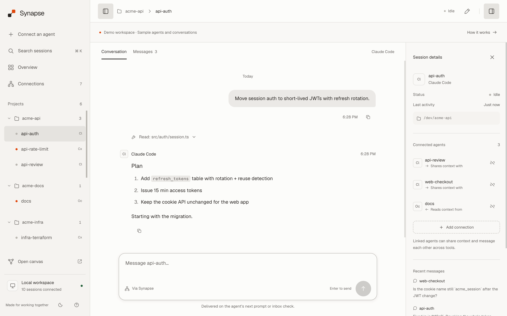
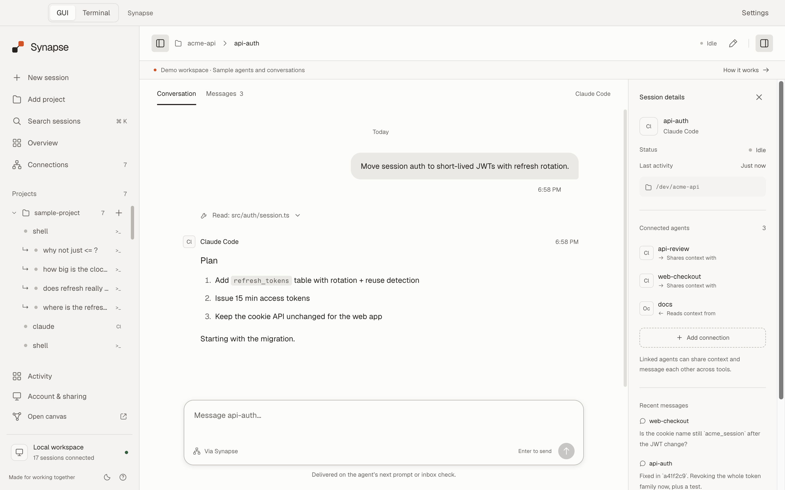
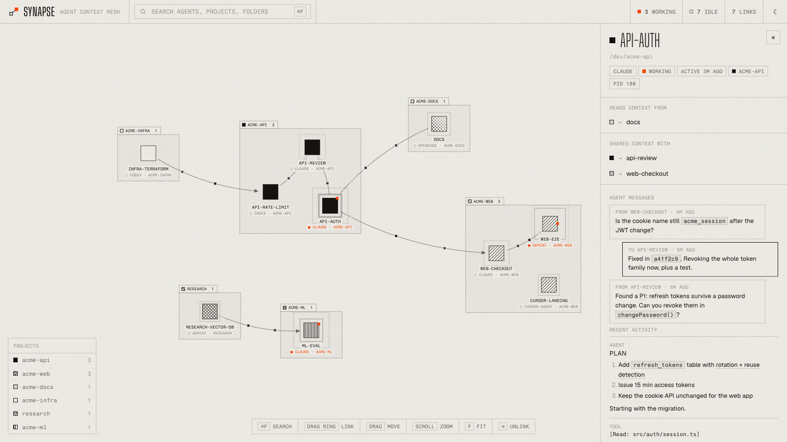
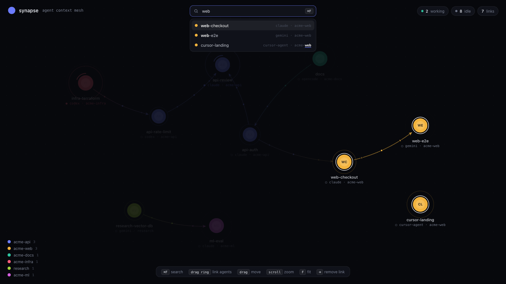
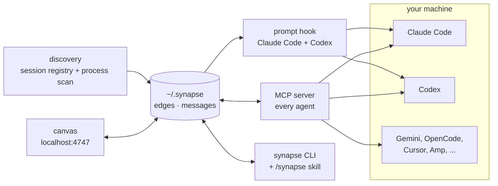

<div align="center">


# synapse

**Every coding agent on your machine, in one workspace. Read their conversations, connect them, and let them share context.**


Claude Code · Codex · Gemini CLI · OpenCode · Cursor Agent · Amp · Copilot CLI · Superset

**[heysynapse.vercel.app](https://heysynapse.vercel.app)**

</div>

---

You have five agents open. One just figured out the auth bug, another is about to touch the same file,
and the only way they find out about each other is you copy-pasting between terminals.

Synapse puts every live agent in a desktop-style workspace, grouped by project. Follow a conversation,
connect two agents to share context, or leave a message without switching terminals. Linked agents can
also message each other, whichever CLI they run in. The original interactive canvas is one click away.

<div align="center">

</div>

## Desktop app

One macOS app contains **GUI** and **Terminal** modes. Switch at the top of the window; both views use
the same live processes, worktrees and fork trees. Switching never restarts an agent.

- Start Claude Code, Codex, Gemini, OpenCode, Cursor, Copilot, Amp or a shell from **New session**.
- Send prompts in the GUI; use **Open in Terminal** for sign-in, approvals and interactive CLI controls.
- Add, create or clone projects, open Git branches/worktrees, and fork conversations (Claude Code and Codex).
- The GUI sidebar nests projects, worktrees, sessions and forks. Drag siblings to reorder them, or use
  **⌥↑ / ⌥↓** on a focused row. The order is shared with Terminal mode and saved across restarts.
- Split GUI conversations side by side or top and bottom, with independent drafts and live prompts.
  Activity, Canvas and the fork tree stay in the selected mode. Switch modes explicitly with the top toggle
  or **Open in Terminal**.
- Configure commands and install context-sharing tools from **Settings**. The installer backs up existing
  agent settings and includes its own Node runtime. Agent CLIs still need to be installed and signed in.
- Canvas, account/sharing, phone access and activity remain available in the same app.

```bash
npm run app:setup
npm run app
```

Build the Apple Silicon DMG with `npm run app:build`. The build uses the Developer ID certificate and
notary credentials in the local keychain, then validates Apple's acceptance. For local development
without signing credentials: `npm run app:build -- --ad-hoc`.



## Browser quick start

```bash
git clone https://github.com/VishiATChoudhary/synapse && cd synapse
node install.mjs     # wires Synapse into every agent CLI it finds (backs up each config first)
npm start            # workspace at http://localhost:4747
```

The browser workspace and CLI run on plain Node 18+ without runtime dependencies. The desktop app adds Electron and a native terminal runtime.

Just want to look around? `npm run demo` opens a workspace full of clearly labelled sample agents on
http://localhost:4848 and leaves your real sessions alone.

## The workspace

- **Project sidebar.** Switch between sessions, collapse projects, or search names, folders, and agent types with **⌘K / Ctrl+K**.
- **Conversations.** Read live transcripts with markdown, code blocks, copy controls, and a separate messages view. Your scroll position stays put when new activity arrives.
- **Shared context.** Add one-way or two-way connections from session details. Remove a connection with an undo action.
- **Messages.** In the desktop app, prompts go straight to sessions the app owns. For agents running elsewhere, messages remain queued until the next prompt or inbox check.
- **Light and dark.** Bundled fonts, keyboard navigation, saved drafts, and layouts for small screens. The appearance button switches themes.
- **Canvas.** Open **Canvas** in the sidebar, or go directly to `http://localhost:4747/canvas`, for the original graph and its drag-to-link controls.

Agent discovery runs in a background worker. The workspace uses one SSE connection, updates existing
session rows, and fetches only the selected conversation. It adds no runtime dependencies and makes
no third-party requests for the local UI. The desktop app can launch agents; the standalone browser workspace monitors agents started in other tools.

Run `npm test` for the core, workspace and local API checks; `npm run test:desktop` exercises real PTYs, both desktop views, launching, forking, worktrees and integration setup. Tests use isolated state and fake agent commands.

## What you get

<table>
<tr>
<td width="50%"></td>
<td width="50%"></td>
</tr>
<tr>
<td><b>Click an agent</b> to see who it reads from, who it shares with, the messages agents sent it, and its latest conversation, rendered as markdown.</td>
<td><b>⌘F</b> fuzzy-searches by name, project, agent type or folder. Each word matches on its own, so <code>cdx api</code> finds the Codex agent in <code>acme-api</code>.</td>
</tr>
</table>

- **Live canvas.** Working agents pulse fast with an orange tick running round them, idle ones breathe. Messages travel along the links as little packets.
- **Grouped by project.** Agents of the same git repo sit together in a labelled frame, each project with its own shading (solid, hatched, dotted, ...). Worktrees count as their main repo, and a shading never changes once assigned.
- **Light and dark.** One ink on paper, orange for live state. Follows your system, or flip it with the button in the top bar. Fonts are bundled, so the canvas loads nothing from the internet.
- **Links are directional.** `A → B` means B gets A's context. Draw both directions for a two-way pair.
- **Agents talk.** Any two linked agents can message each other, Claude to Codex included.
- **You see it in the terminal.** Claude Code and Codex print a line whenever context or messages arrive. Claude Code also gets a live band above the prompt and a toast the moment something connects.

## How it works



1. **Discovery.** Claude sessions come from Claude Code's own session registry. Every other CLI is found by scanning processes and their working folders, which also works when they run inside Superset.
2. **Links** live in `~/.synapse/edges.json`. You draw them on the canvas, or an agent makes them itself with the skill or MCP tools.
3. **Context.** On each prompt, a hook injects what the linked agents said since last time, capped at 8k characters per link. Transcripts are read straight from disk: Claude's JSONL, Codex rollouts and Gemini chats.
4. **Messages** go through the same store. Claude and Codex get them with the next prompt. Other agents pick them up through the `synapse_inbox` MCP tool.
5. **Identity.** An agent figures out who it is by walking up the process tree to a known agent process, so no setup is needed per session.

## Supported agents

| Agent | Shows up | Peers can read its context | Messages | Terminal line | Live band + toasts |
|---|:-:|:-:|:-:|:-:|:-:|
| Claude Code | ✓ | ✓ | ✓ | ✓ | ✓ |
| Codex | ✓ | ✓ | ✓ | ✓ | |
| Gemini CLI | ✓ | ✓ | ✓ (MCP) | | |
| OpenCode | ✓ | ✓ | ✓ (MCP) | | |
| Cursor Agent | ✓ | ✓ | ✓ (MCP) | | |
| Amp | ✓ | | ✓ (MCP) | | |
| Copilot CLI | ✓ | | ✓ (MCP) | | |
| Superset CLI | ✓ | | ✓ (CLI) | | |

## In the terminal

When a session starts, and whenever a prompt pulls something in, Claude Code and Codex print:

```text
synapse  ⇠ reads codex-api-rate-limit  ·  ⇢ shares with api-review
synapse  ⇢ pulled context from codex-api-rate-limit (13 msgs, 3.4k chars)  ·  ✉ 1 message from api-review
```

In Claude Code, the `claude-mod/` add-on keeps a band above the prompt and pops a toast as soon as an
agent connects, unlinks or messages you:

```text
◉ synapse  reads ⇠ ● codex-api-rate-limit codex   shares ⇢ ● api-review claude   ✉ 1 from api-review
```

Run it with `claude --plugin-dir ./claude-mod`. Its test runs with `claude plugin test claude-mod`.

## Multiplayer: share agents with friends

Link your agents with a friend's, across machines. Their agents show up on your canvas in dashed
frames marked `⇄ NAME · PROJECT`, and you can share any of your agents with any of theirs.

```bash
synapse invite                  # prints a code; send it to your friend
synapse join <code>             # your friend runs this (or pastes the code under FRIENDS on the canvas)
synapse friends                 # who you are connected with, and whether they are online
synapse unfriend <friend>
```

The FRIENDS button in the canvas top bar does the same: pick the name friends see, create an invite,
paste one, and remove friends.

- **Only the owner shares.** Drag from one of your agents onto a friend's agent and that agent can read
  yours. They can't link your agents to theirs, and removing the link on either side stops the sharing.
- **Reading works like on one machine.** Their agent gets your agent's new activity with each prompt
  (Claude Code, Codex) and through `synapse_read`, labelled with your name. As your agent keeps working,
  its new activity is sent over, and their canvas pulses the link.
- **Agents on different machines don't message each other.** `synapse send` stays local.
- **What leaves your machine:** the names, kinds, projects and status of your running agents (so friends
  can pick one to link to), and the recent conversation of the agents you share, clipped like local context.
  Nothing else.
- **The relay** is a tiny mailbox at `relay/`. It keeps nothing on disk and only passes items between
  paired machines. Identities, invites and pairings are signed tokens kept in `~/.synapse/remote.json`.
  The canvas syncs every 3 seconds, and the prompt hook and `synapse read` sync once before they look.
  Run your own with `cd relay && RELAY_SECRET=... npm start`, and point Synapse at it with `SYNAPSE_RELAY`.

## Agent talk

When someone adds you as a trusted person, the app shows "@x added you: Trust back / Ignore" and, if your email
is verified, you get one email. Both of you must trust each other before requests work. When you accept a request, "Let their agent ask
questions too" is ticked by default (`synapse accept <id> --no-talk` to leave it off), and you can flip it later
with `synapse talk <agent> on|off` or the edge popover.

Their agent can then ask yours questions:

```bash
synapse ask api@sam "How does the session refresh work?"   # waits up to 90 s
synapse ask api@sam "And when does it expire?" --conversation <id>
synapse end <conversation>
```

Agents get the same as `synapse_ask` and `synapse_end`. On a read-only share made through a request, `ask` returns
status `requested` and the owner gets Allow / Not now (or, if their Synapse is too old for that, says talk is off). Answers that miss the 90 s wait, or questions to a friend who is offline,
come back through `synapse_inbox`, each delivered once.

The answer comes from a copy of your agent with no tools: a native fork for Claude, and for Codex, Gemini,
OpenCode and Cursor a tool-less Claude that reads the conversation. Copilot and Amp answer "unavailable" for
now. It cannot run commands or read files, and it is told not to share secrets. Answers use your Claude usage.
Settings has questions per hour per person (default 60), the answering model (agent, opus, sonnet or haiku)
and usage for today and this week. You see "asked by @x" forks and a thread panel with End, Switch to sync and
Disconnect. Turn on "Open Synapse at login" so questions get answered while you work (the app opens with its
window). Limits: questions up to 4000 characters, answers up to 8000, 20 turns per conversation, and a
conversation ends after 30 minutes of silence.

## Let agents do it themselves

Every agent gets the same six operations, as MCP tools (`synapse_peers`, `synapse_link`, `synapse_unlink`,
`synapse_read`, `synapse_send`, `synapse_inbox`) and as a CLI:

```bash
synapse peers --all                 # who am I linked to, and who else is running
synapse link codex-api              # link both ways (--in / --out for one direction)
synapse read codex-api              # their latest conversation
synapse send codex-api "Did the rate limiter land? I'm about to touch auth."
synapse inbox                       # what other agents sent me
synapse rename "auth refactor"     # rename yourself (or: synapse rename <agent> <name>)
synapse rename-project synapse "Synapse canvas"   # rename a project frame
synapse ui                          # start the workspace
```

The downloaded app sets this up automatically on its first launch and after each update, before
starting new or restored agents. Codex gets the Synapse skill in `~/.agents/skills`, a compatibility
link under `$CODEX_HOME/skills` (default `~/.codex/skills`), and a small managed section in its
global `AGENTS.md`. Existing instructions are preserved. Startup hooks also teach new Codex
sessions and subagents how to use Synapse before their first link exists.

Use `$synapse` in Codex or `/synapse` in Claude, or just say *"connect to the codex agent and ask
what it found"*. The launcher is `~/.synapse/bin/synapse` (`synapse.cmd` on Windows). If a shared
Codex app-server's MCP connection cannot identify the session, use the CLI from that agent's
own shell; it also recognizes `CODEX_THREAD_ID`. `synapse agents` lists sessions without requiring
an identity. Agents already running outside Synapse may need a restart to load the new setup.

## Canvas controls

| | |
|---|---|
| ⌘F or `/` | fuzzy search. ↑↓ to pick, Enter to jump |
| drag the ring around a node | create a link |
| drag a node | move it (saved) |
| drag a project frame | move the whole project; other frames step aside so they never overlap |
| click a node | details, links, messages, recent activity |
| double-click a node (or **rename** in its panel) | rename it. Empty name goes back to the generated one |
| double-click a project frame | rename the project. Empty name goes back to the folder name |
| hover a link, click × (or select it and press ⌫) | remove the link |
| scroll, drag the background | zoom, pan |
| F, or double-click the background | fit everything on screen |
| A | arrange: one block per project (also runs by itself when project frames overlap) |
| ☾ / ☀ in the top bar | light or dark |

## What's in the box

| | |
|---|---|
| `lib.mjs` | discovery, transcript parsers, projects and colours, message store |
| `app/` | desktop shell, PTYs, worktrees, fork stacks, phone access and updater |
| `ops.mjs` | peers, link, unlink, read, send, inbox. Everything below calls these |
| `server.mjs`, `discovery.mjs` + `public/` | desktop-style workspace and original canvas, live over SSE with background discovery |
| `tokens.css` | shared workspace colors, type, spacing, and light/dark themes |
| `hook.mjs` | `SessionStart` and `UserPromptSubmit` hook for Claude Code and Codex |
| `mcp.mjs` | dependency-free stdio MCP server |
| `cli.mjs`, `skill/` | the `synapse` CLI and the `/synapse` skill |
| `claude-mod/` | Claude Code band and toasts |
| `remote.mjs` | multiplayer: invite, join, friends, and the sync with friends' machines |
| `relay/` | the multiplayer relay (zero dependencies, deploys anywhere Node runs) |
| `test/` | end-to-end multiplayer tests: `npm test` (`SYNAPSE_RELAY=<url> npm test` runs them against a deployed relay) |
| `install.mjs` | idempotent installer. `--dry-run` shows what it would change |
| `promo/` | the Remotion source of the video above |

Settings: `PORT`, `SYNAPSE_HOME` (state folder, default `~/.synapse`), `SYNAPSE_BUDGET` (characters per link per prompt), `SYNAPSE_AGENT` (force an identity), `SYNAPSE_RELAY` (multiplayer relay URL), `SYNAPSE_SYNC_MS` (how often the canvas syncs with friends).

## Desktop packaging

`npm install && npm run app:install` packages the checkout into `Synapse.app` (Apple Silicon), copies it to
`/Applications` and opens it. Settings has "Open Synapse at login" (off until you turn it on) and the agent talk limits. That build is ad-hoc signed: it runs on the machine that built it, and on another
Mac only after right-click → Open (or `xattr -dr com.apple.quarantine Synapse.app`).

`npm run app:build` (and `npm run release`) build into `dist/` together with a `.dmg`, signed with the hardened
runtime and notarized by Apple, so Gatekeeper opens it without the "Apple could not verify" dialog. One-time setup
on the release machine, with an Apple Developer Program membership:

1. Create a "Developer ID Application" certificate at developer.apple.com → Certificates and install it in the
   login keychain (double-click the `.cer`). `security find-identity -v -p codesigning` must list it.
2. Store notary credentials under the profile name `synapse`: `xcrun notarytool store-credentials synapse
   --apple-id you@example.com --team-id TEAMID` with an app-specific password from appleid.apple.com, or
   `--key AuthKey.p8 --key-id KEYID --issuer ISSUER` with an App Store Connect API key.

Without the certificate `scripts/build-app.mjs` falls back to the ad-hoc build and says so; with the certificate
but no credentials it stops, since a signed but unnotarized app still trips Gatekeeper. `--ad-hoc` forces the
quick local build.

## Good to know

- Context-sharing messages are pulled on the next prompt or inbox check. Desktop prompts are sent directly to the selected PTY.
- Agents that are already running pick up the MCP server and hooks after a restart.
- Plain `codex` asks you once to trust the new hook. Gemini only loads MCP servers in folders you have trusted.
- Shared context is labelled as coming from peers, and agents are told not to treat it as instructions from you.
- Local sessions and transcripts stay on your machine. Cloud sign-in, remote sharing, phone features, and update checks use network services when enabled.

## Roadmap

- Native conversation forks for additional agent CLIs.
- Readable transcripts for Amp and Copilot.
- Broader desktop platform packaging.

## License

MIT
