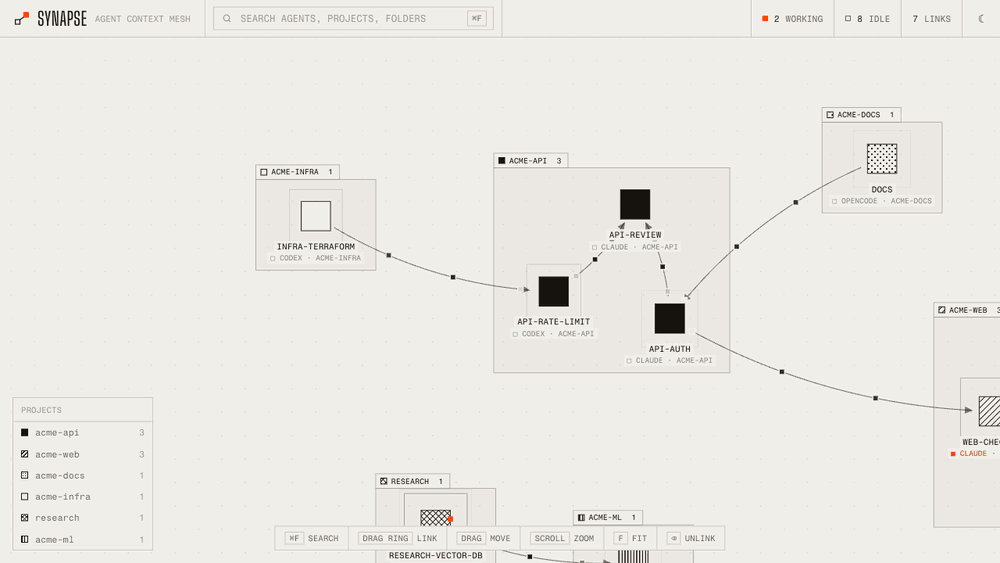
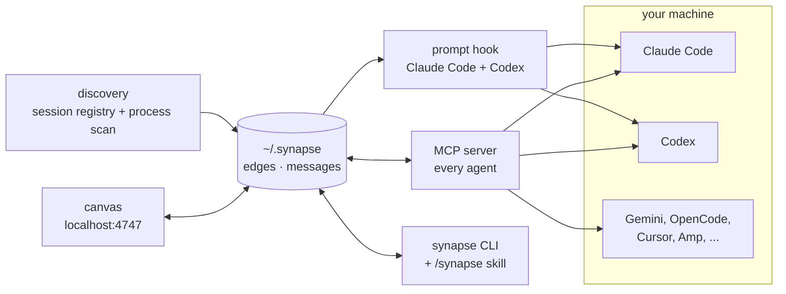

<div align="center">


# synapse

**Every coding agent on your machine, on one canvas. Draw a line between two of them and they share context.**


Claude Code · Codex · Gemini CLI · OpenCode · Cursor Agent · Amp · Copilot CLI · Superset

**[heysynapse.vercel.app](https://heysynapse.vercel.app)**

</div>

---

You have five agents open. One just figured out the auth bug, another is about to touch the same file,
and the only way they find out about each other is you copy-pasting between terminals.

Synapse puts every live agent on a canvas as a pulsing node. **Drag from one agent to another and the
second one can see what the first is doing.** Linked agents can also message each other, whichever
CLI they run in.

<div align="center">

</div>

## Quick start

```bash
git clone https://github.com/VishiATChoudhary/synapse && cd synapse
node install.mjs     # wires Synapse into every agent CLI it finds (backs up each config first)
npm start            # canvas at http://localhost:4747
```

No `npm install`: Synapse is plain Node 18+ with zero dependencies.

Just want to look around? `npm run demo` opens a canvas full of made-up agents on
http://localhost:4848 and leaves your real sessions alone.

## What you get

<table>
<tr>
<td width="50%"></td>
<td width="50%"></td>
</tr>
<tr>
<td><b>Click an agent</b> to see who it reads from, who it shares with, the messages agents sent it, and its latest conversation, rendered as markdown.</td>
<td><b>⌘F</b> fuzzy-searches by name, project, agent type or folder. Each word matches on its own, so <code>cdx api</code> finds the Codex agent in <code>acme-api</code>.</td>
</tr>
</table>

- **Live canvas.** Working agents pulse fast with an orange tick running round them, idle ones breathe. Messages travel along the links as little packets.
- **Grouped by project.** Agents of the same git repo sit together in a labelled frame, each project with its own shading (solid, hatched, dotted, ...). Worktrees count as their main repo, and a shading never changes once assigned.
- **Light and dark.** One ink on paper, orange for live state. Follows your system, or flip it with the button in the top bar. Fonts are bundled, so the canvas loads nothing from the internet.
- **Links are directional.** `A → B` means B gets A's context. Draw both directions for a two-way pair.
- **Agents talk.** Any two linked agents can message each other, Claude to Codex included.
- **You see it in the terminal.** Claude Code and Codex print a line whenever context or messages arrive. Claude Code also gets a live band above the prompt and a toast the moment something connects.

## How it works



1. **Discovery.** Claude sessions come from Claude Code's own session registry. Every other CLI is found by scanning processes and their working folders, which also works when they run inside Superset.
2. **Links** live in `~/.synapse/edges.json`. You draw them on the canvas, or an agent makes them itself with the skill or MCP tools.
3. **Context.** On each prompt, a hook injects what the linked agents said since last time, capped at 8k characters per link. Transcripts are read straight from disk: Claude's JSONL, Codex rollouts and Gemini chats.
4. **Messages** go through the same store. Claude and Codex get them with the next prompt. Other agents pick them up through the `synapse_inbox` MCP tool.
5. **Identity.** An agent figures out who it is by walking up the process tree to a known agent process, so no setup is needed per session.

## Supported agents

| Agent | Shows up | Peers can read its context | Messages | Terminal line | Live band + toasts |
|---|:-:|:-:|:-:|:-:|:-:|
| Claude Code | ✓ | ✓ | ✓ | ✓ | ✓ |
| Codex | ✓ | ✓ | ✓ | ✓ | |
| Gemini CLI | ✓ | ✓ | ✓ (MCP) | | |
| OpenCode | ✓ | | ✓ (MCP) | | |
| Cursor Agent | ✓ | | ✓ (MCP) | | |
| Amp | ✓ | | ✓ (MCP) | | |
| Copilot CLI | ✓ | | ✓ (MCP) | | |
| Superset CLI | ✓ | | ✓ (CLI) | | |

## In the terminal

When a session starts, and whenever a prompt pulls something in, Claude Code and Codex print:

```text
synapse  ⇠ reads codex-api-rate-limit  ·  ⇢ shares with api-review
synapse  ⇢ pulled context from codex-api-rate-limit (13 msgs, 3.4k chars)  ·  ✉ 1 message from api-review
```

In Claude Code, the `claude-mod/` add-on keeps a band above the prompt and pops a toast as soon as an
agent connects, unlinks or messages you:

```text
◉ synapse  reads ⇠ ● codex-api-rate-limit codex   shares ⇢ ● api-review claude   ✉ 1 from api-review
```

Run it with `claude --plugin-dir ./claude-mod`. Its test runs with `claude plugin test claude-mod`.

## Multiplayer: share agents with friends

Link your agents with a friend's, across machines. Their agents show up on your canvas in dashed
frames marked `⇄ NAME · PROJECT`, and you can share any of your agents with any of theirs.

```bash
synapse invite                  # prints a code; send it to your friend
synapse join <code>             # your friend runs this (or pastes the code under FRIENDS on the canvas)
synapse friends                 # who you are connected with, and whether they are online
synapse unfriend <friend>
```

The FRIENDS button in the canvas top bar does the same: pick the name friends see, create an invite,
paste one, and remove friends.

- **Only the owner shares.** Drag from one of your agents onto a friend's agent and that agent can read
  yours. They can't link your agents to theirs, and removing the link on either side stops the sharing.
- **Reading works like on one machine.** Their agent gets your agent's new activity with each prompt
  (Claude Code, Codex) and through `synapse_read`, labelled with your name. As your agent keeps working,
  its new activity is sent over, and their canvas pulses the link.
- **Agents on different machines don't message each other.** `synapse send` stays local.
- **What leaves your machine:** the names, kinds, projects and status of your running agents (so friends
  can pick one to link to), and the recent conversation of the agents you share, clipped like local context.
  Nothing else.
- **The relay** is a tiny mailbox at `relay/`. It keeps nothing on disk and only passes items between
  paired machines. Identities, invites and pairings are signed tokens kept in `~/.synapse/remote.json`.
  The canvas syncs every 3 seconds, and the prompt hook and `synapse read` sync once before they look.
  Run your own with `cd relay && RELAY_SECRET=... npm start`, and point Synapse at it with `SYNAPSE_RELAY`.

## Let agents do it themselves

Every agent gets the same six operations, as MCP tools (`synapse_peers`, `synapse_link`, `synapse_unlink`,
`synapse_read`, `synapse_send`, `synapse_inbox`) and as a CLI:

```bash
synapse peers --all                 # who am I linked to, and who else is running
synapse link codex-api              # link both ways (--in / --out for one direction)
synapse read codex-api              # their latest conversation
synapse send codex-api "Did the rate limiter land? I'm about to touch auth."
synapse inbox                       # what other agents sent me
synapse rename "auth refactor"     # rename yourself (or: synapse rename <agent> <name>)
synapse rename-project synapse "Synapse canvas"   # rename a project frame
synapse ui                          # start the canvas
```

The installer puts the launcher at `~/.synapse/bin/synapse` and adds a **`/synapse` skill** to Claude
Code and Codex, so you can just say *"connect to the codex agent and ask what it found"*.

## Canvas controls

| | |
|---|---|
| ⌘F or `/` | fuzzy search. ↑↓ to pick, Enter to jump |
| drag the ring around a node | create a link |
| drag a node | move it (saved) |
| drag a project frame | move the whole project; other frames step aside so they never overlap |
| click a node | details, links, messages, recent activity |
| double-click a node (or **rename** in its panel) | rename it. Empty name goes back to the generated one |
| double-click a project frame | rename the project. Empty name goes back to the folder name |
| hover a link, click × (or select it and press ⌫) | remove the link |
| scroll, drag the background | zoom, pan |
| F, or double-click the background | fit everything on screen |
| A | arrange: one block per project (also runs by itself when project frames overlap) |
| ☾ / ☀ in the top bar | light or dark |

## What's in the box

| | |
|---|---|
| `lib.mjs` | discovery, transcript parsers (Claude, Codex, Gemini), projects and colours, message store |
| `ops.mjs` | peers, link, unlink, read, send, inbox. Everything below calls these |
| `server.mjs` + `public/` | the canvas: one HTML file, canvas 2D, live over SSE |
| `hook.mjs` | `SessionStart` and `UserPromptSubmit` hook for Claude Code and Codex |
| `mcp.mjs` | dependency-free stdio MCP server |
| `cli.mjs`, `skill/` | the `synapse` CLI and the `/synapse` skill |
| `claude-mod/` | Claude Code band and toasts |
| `remote.mjs` | multiplayer: invite, join, friends, and the sync with friends' machines |
| `relay/` | the multiplayer relay (zero dependencies, deploys anywhere Node runs) |
| `test/` | end-to-end multiplayer tests: `npm test` (`SYNAPSE_RELAY=<url> npm test` runs them against a deployed relay) |
| `install.mjs` | idempotent installer. `--dry-run` shows what it would change |
| `promo/` | the Remotion source of the video above |

Settings: `PORT`, `SYNAPSE_HOME` (state folder, default `~/.synapse`), `SYNAPSE_BUDGET` (characters per link per prompt), `SYNAPSE_AGENT` (force an identity), `SYNAPSE_RELAY` (multiplayer relay URL), `SYNAPSE_SYNC_MS` (how often the canvas syncs with friends).

## Desktop app

`npm install && npm run app:install` packages the checkout into `Synapse.app` (Apple Silicon), copies it to
`/Applications` and opens it. `npm run app:build` only builds, into `dist/`, together with a `.dmg`. The app is
ad-hoc signed: it runs on the machine that built it, and on another Mac only after right-click → Open (or
`xattr -dr com.apple.quarantine Synapse.app`), since there is no Developer ID or notarization.

## Good to know

- Messages are pulled, not pushed: an agent sees them with its next prompt or inbox check.
- Agents that are already running pick up the MCP server and hooks after a restart.
- Plain `codex` asks you once to trust the new hook. Gemini only loads MCP servers in folders you have trusted.
- Shared context is labelled as coming from peers, and agents are told not to treat it as instructions from you.
- Everything stays on your machine until you add a friend. Without friends Synapse makes no network calls.

## Roadmap

- Push delivery, so an idle agent wakes up when a message arrives.
- Readable transcripts for OpenCode, Amp and Copilot.

## License

MIT
